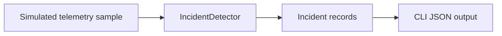

# Architecture — PR #1

The core library is independent of Azure and AI dependencies. Threshold-based detection is intentionally simple and deterministic. Future PRs will introduce telemetry adapters, durable incident state, correlation, LLM-assisted diagnosis, human-approved remediation, audit logging and cloud deployment.

**Safety boundary:** This version never changes infrastructure, invokes Azure APIs, or executes recovery actions.
