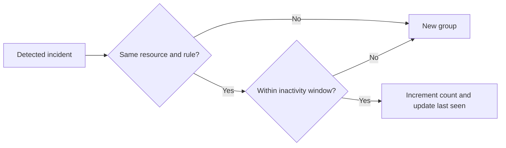

# Incident correlation and deduplication (PR #5)

`IncidentCorrelator` groups alert events by **resource ID and alert rule ID**, using an inactivity window (default five minutes). The rule ID is parsed from the existing `AlertRuleEngine` reason format (`Rule {id}: ...`). Legacy incidents without that format are grouped by their full reason text.

Repeated events inside the window update the occurrence count, last-seen timestamp, latest reason, and maximum severity. An event outside the window replaces the current active group with a new one. The window is measured from the last event in the group.

## Limitations and safety

- State is **in memory** and process-local; groups are not durable or distributed.
- Only the current group for each correlation key is retained. Historical groups are not archived.
- Out-of-order timestamps for the same key are rejected to avoid silently corrupting the timeline.
- Rule ID extraction depends on the current reason string contract; structured rule identifiers are planned for a later schema revision.
- This module only groups alerts. It never executes remediation or cloud operations.
