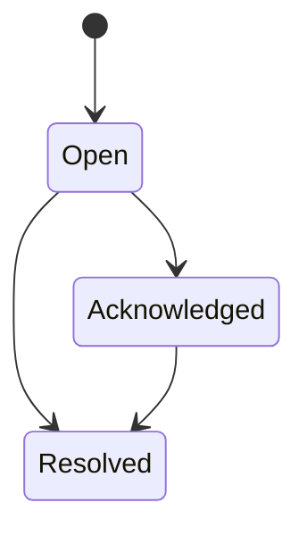

# Incident lifecycle (PR #3)

Each detected `Incident` can be registered in an `IncidentLifecycleStore`. Supported states:

Transitions require an actor and a timestamp. Each transition captures its prior state, new state, timestamp, actor and optional note. Timestamps must not move backwards. Incident IDs are unique, and resolved incidents are terminal.

The store is **in-memory and process-local**; it is not durable, distributed, or authenticated. The actor field is supplied by the caller and must not be treated as a verified identity. Thread safety is provided by a lock. Persistent storage, authorization and audit export are planned for later PRs. This feature never invokes remediation actions.
